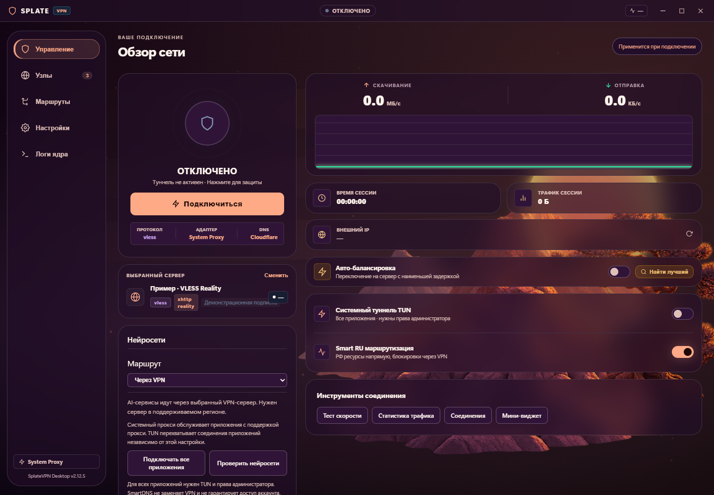
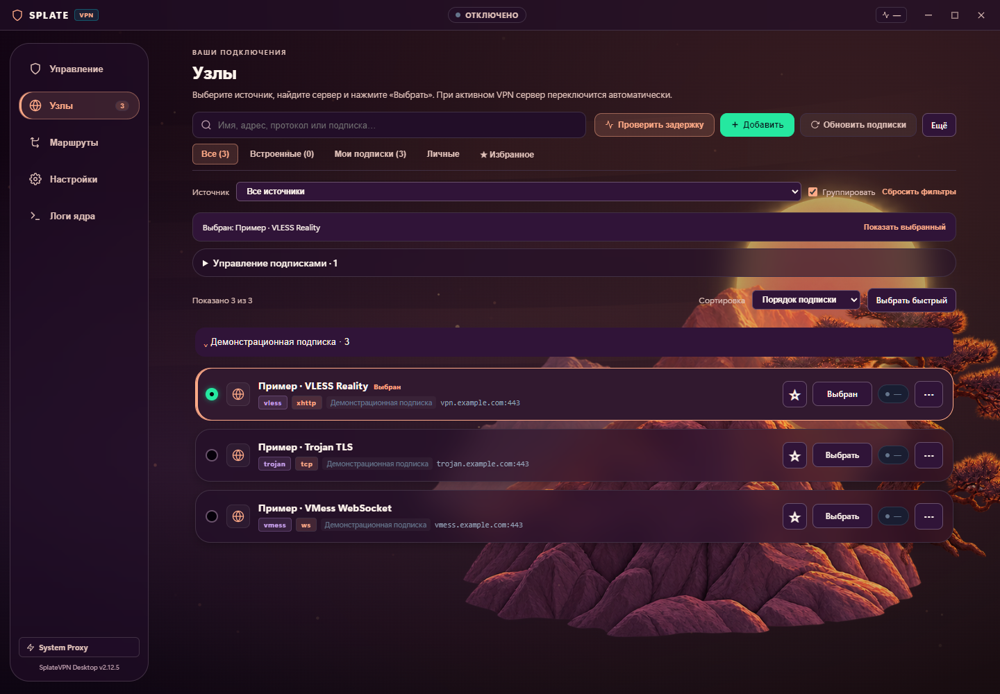
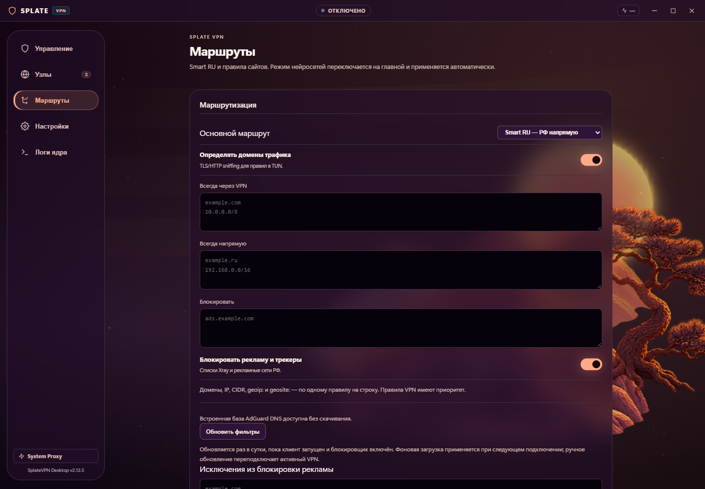
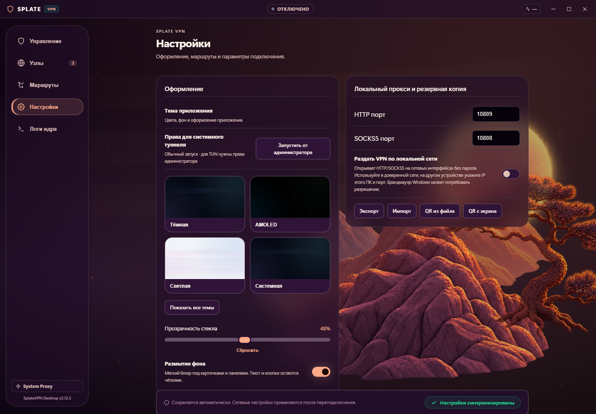

<p align="center">
  
</p>

<h1 align="center">SplateVPN Desktop — VPN-клиент для Windows на Xray</h1>

<p align="center">
  VLESS / Reality, VMess, Trojan и Shadowsocks.<br />
  Системный прокси, TUN через Wintun, подписки, Smart RU и автоматический выбор сервера.
</p>

<p align="center">
  
  
  
  
</p>

<p align="center">
  <a href="https://github.com/splatedk-web/splatevpn-xray-client-windows/releases">Скачать для Windows</a> ·
  <a href="#скриншоты">Скриншоты</a> ·
  <a href="#быстрый-старт">Быстрый старт</a> ·
  <a href="https://github.com/splatedk-web/splatevpn-xray-client">Версия для Android</a> ·
  <a href="https://github.com/splatedk-web/splatevpn-xray-client-windows/issues">Сообщить об ошибке</a>
</p>

> Проект находится в активной разработке. Версия исходников — **2.12.5**. Для подключения нужен совместимый сервер или подписка. Наличие сборки с конкретными изменениями проверяйте в Releases.

## О приложении

**SplateVPN Desktop (Splate VPN)** — клиент для подключения Windows-компьютера к прокси-серверам через Xray-core. Он может работать как системный HTTP/SOCKS5-прокси либо перехватывать трафик через TUN-адаптер с помощью tun2socks и Wintun.

Приложение не предоставляет собственную сеть VPN-серверов. Можно добавить свою конфигурацию, URL подписки или воспользоваться встроенными списками из сторонних публичных источников. Их доступность, скорость и условия работы зависят от владельцев серверов.

**English:** SplateVPN Desktop is a Windows VPN client based on Xray-core. It supports VLESS / Reality, VMess, Trojan, Shadowsocks, subscription management, system proxy and Wintun-based TUN mode, automatic server selection and configurable DNS. Bring a compatible server or subscription; the app does not operate its own VPN server network.

## Скриншоты

Текущий WebView-интерфейс версии **2.12.5**, тема **Sunset**. Снимки сделаны **20 октября 2026 года** с демонстрационными серверами `example.com`, без подключения к ним. На главной показано отключённое состояние; скорость и задержка реального подключения здесь не измерялись.

<table>
  <tr><th>Управление</th><th>Узлы и подписки</th></tr>
  <tr>
    <td width="50%"><a href="docs/screenshots/home.png"></a></td>
    <td width="50%"><a href="docs/screenshots/servers.png"></a></td>
  </tr>
  <tr><th>Маршруты</th><th>Настройки</th></tr>
  <tr>
    <td><a href="docs/screenshots/routing.png"></a></td>
    <td><a href="docs/screenshots/settings.png"></a></td>
  </tr>
</table>

## Режимы подключения

| Режим | Что охватывает | Права администратора |
| --- | --- | --- |
| Системный прокси | Приложения, которые используют системный прокси Windows или явно настроенный HTTP/SOCKS5-прокси. Остальные программы могут подключаться напрямую. | Обычно не нужны. |
| TUN / Wintun | Трафик, перехваченный виртуальным сетевым адаптером, с применением правил маршрутизации клиента. | Нужны. |

**Smart RU** оставляет подходящие российские направления напрямую по правилам. Глобальный профиль направляет трафик через VPN с учётом явно настроенных исключений. Отдельный режим SmartDNS для AI может создавать прямой маршрут к провайдеру SmartDNS, поэтому общий внешний IP VPN не описывает путь всех запросов.

## Возможности

- **Протоколы:** VLESS с Reality / TLS, VMess, Trojan, Shadowsocks. Поддерживаются XHTTP, WebSocket и другие транспорты совместимых конфигураций Xray.
- **Серверы:** импорт ссылок и подписок, встроенные источники, поиск, избранное, группировка, редактор, QR из файла или с экрана, импорт и экспорт.
- **Проверки:** TCP-доступность и HTTPS-проверка через конфигурацию узла. Результаты появляются по мере проверки; операцию можно остановить. Открытый TCP-порт не подтверждает, что VPN работает.
- **Автовыбор и балансировщик:** начальный подбор, восстановление при отказе и фоновая оптимизация по настройкам. Кандидаты проверяются отдельно; переключение может прервать существующие соединения.
- **Маршрутизация:** Smart RU, глобальный профиль, пользовательские правила доменов, IP и CIDR, блокировка направлений.
- **DNS и AI:** общий DNS и отдельный SmartDNS для AI, выбор провайдера, автоподбор и проверка публичных страниц Gemini, ChatGPT и Claude. TLS-фрагментация SmartDNS настраивается отдельно.
- **Фильтрация рекламы:** доменная база AdGuard DNS, обновление при работающем клиенте и пользовательские исключения.
- **Инструменты:** график скорости и счётчики Xray, тест скорости, история трафика, журнал ядра, диагностика и компактное окно статуса.
- **Работа с Windows:** трей, автозапуск, восстановление прежнего системного прокси и контроль дочерних процессов ядра.
- **Оформление:** 12 вариантов темы, анимированные фоны, регулировка прозрачности и размытия стекла.
- **Резервные копии:** экспорт и импорт настроек, серверов и подписок в защищённом паролем формате `.spcfg`.

## Ограничения

- **Kill Switch в этой сборке не поддерживается.** Отдельной защиты через глобальную DNS-политику Windows также нет. Соответствующие недоступные настройки не следует считать работающими функциями.
- **Маршрутизация по процессам Windows не поддерживается.** Для текущего клиента доступны правила направлений: домены, IP и CIDR.
- Системный прокси не охватывает весь трафик компьютера. TUN требует повышения прав и работоспособного физического сетевого маршрута.
- SmartDNS, фильтры и публичные серверы зависят от сторонних сервисов. Подтверждение публичной страницы не гарантирует вход в аккаунт, работу API, видео или звонков.
- Доменная фильтрация не удаляет всю рекламу, особенно если реклама и основной контент приходят с одного домена.
- Показатели трафика берутся из метрик Xray, а не из общих счётчиков сетевых адаптеров. Они не описывают весь трафик Windows.
- Поддерживаемая цель сборки — **Windows x64**. Полный набор сценариев на каждой версии Windows и каждом оборудовании не проверен.

## Быстрый старт

1. Откройте [Releases](https://github.com/splatedk-web/splatevpn-xray-client-windows/releases) и выберите установщик или portable-архив подходящей версии.
2. Для portable распакуйте архив целиком и запустите `SplateClient.exe`. Папки `core`, `wwwroot`, `Assets` и `runtime` должны оставаться рядом с приложением; перенос одного EXE недостаточен.
3. В разделе **«Узлы»** добавьте ссылку или подписку. Выберите сервер; при необходимости выполните проверку задержки.
4. На главной проверьте режим маршрутизации и настройки AI, затем подключитесь.
5. Если нужен TUN, используйте **«Настройки» → «Запустить от администратора»**, включите TUN и подключитесь. В обычном режиме обслуживаются программы с поддержкой прокси.

Настройки и списки хранятся в `%APPDATA%\SplateVPN`. Клиент допускает один экземпляр; перед запуском другой версии закройте предыдущую. Установочный пакет рассчитан на **Windows 10 / 11 x64**. Подготовленные поставки используют локальный Fixed Version WebView2 Runtime; обычная установка системного WebView2 не заменяет отсутствующую папку `runtime` в этой реализации.

## Сборка из исходников

Проект использует **C# / .NET 8, WPF и WebView2**. Для сборки нужен .NET 8 SDK на Windows; интерфейс находится в `wwwroot`, сетевые службы — в `Services`.

```powershell
git clone https://github.com/splatedk-web/splatevpn-xray-client-windows.git
cd splatevpn-xray-client-windows
dotnet restore SplateClientDesktop.csproj
dotnet build SplateClientDesktop.csproj -c Release
```

**Сборка проекта не загружает нативные зависимости автоматически.** Для запуска подготовьте:

| Файлы | Назначение и источник |
| --- | --- |
| `core/xray.exe`, `core/geoip.dat`, `core/geosite.dat` | [Xray-core](https://github.com/XTLS/Xray-core/releases). Локальная проверка текущего проекта выполнена с Xray **26.9.9**, Windows AMD64. Геобазы должны соответствовать используемым правилам. |
| `core/tun2socks.exe` | [tun2socks](https://github.com/xjasonlyu/tun2socks/releases), Windows AMD64. |
| `core/wintun.dll` | [Wintun](https://www.wintun.net/), вариант AMD64. |
| `runtime/WebView2/` | [Microsoft WebView2 Fixed Version Runtime](https://developer.microsoft.com/en-us/microsoft-edge/webview2/), x64. Файлы `msedgewebview2.exe`, `msedge.dll` и `icudtl.dat` должны лежать непосредственно в этой папке. |

Некоторые зависимости уже могут присутствовать в рабочей копии; `xray.exe` и полный WebView2 Runtime не поставляются через обычный `git clone`. Учитывайте лицензии сторонних компонентов при распространении собственной сборки. Скрипт `build_installer.ps1` дополнительно проверяет состав поставки и требует Inno Setup для установщика.

Проверки C#:

```powershell
dotnet run --project tests/PortChecks/PortChecks.csproj -c Release
```

Проверки используют локальные заглушки, временные файлы и процессы Xray; для полного набора нужен `core/xray.exe`. Проверки, которые меняют сетевые маршруты, вынесены в отдельные параметры запуска и не нужны для обычного прогона.

Скриншоты README воспроизводятся скриптом `scripts/capture-readme.cjs`: Node.js, пакет `playwright` и установленный Microsoft Edge. Скрипт запускает отдельный браузер с тестовым IPC, не использует личные настройки и не подключает VPN.

## История и обратная связь

Предыдущие заметки по версиям сохранены в [CHANGELOG.md](CHANGELOG.md). Они описывают этапы разработки и могут содержать уже заменённые настройки.

Для ошибки создайте [Issue](https://github.com/splatedk-web/splatevpn-xray-client-windows/issues): версия клиента и Windows, режим прокси/TUN, шаги воспроизведения и результат. Перед публикацией журналов удалите ключи, пароли, адреса приватных серверов и ссылки подписок.
